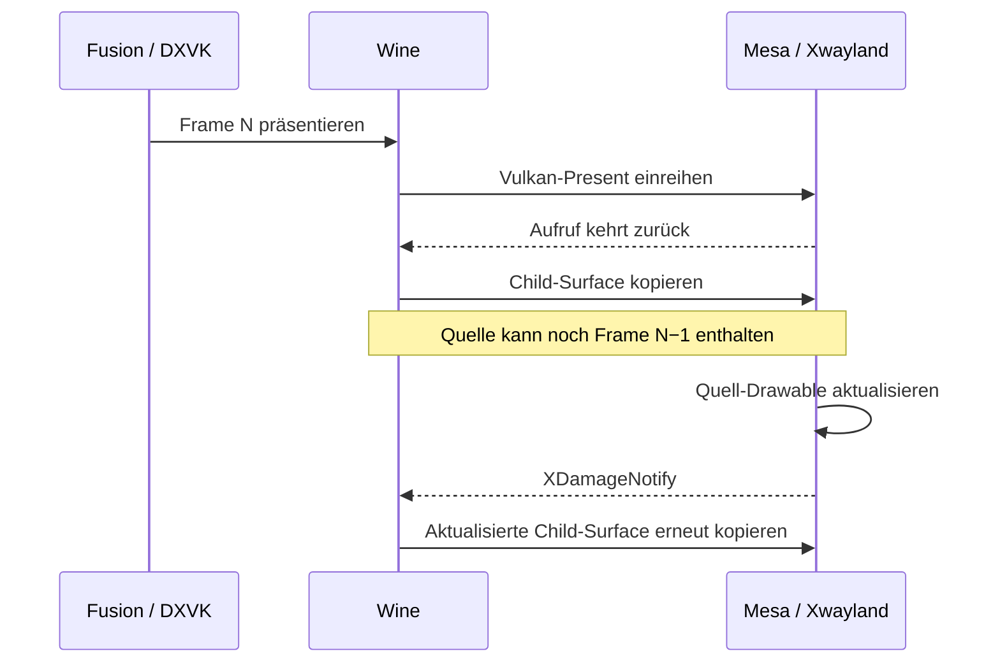

# Untersuchung des Frame-Handlings in Fusion unter Linux

Stand: 31. Oktober 2026. Ergebnis: Ein ereignisgesteuerter Wine-X11-Patch ist auf
dem getesteten System die bisher überzeugendste Lösung. Der eigene Proton-Fork
ist die Build- und Auslieferungsbasis; die eigentliche Korrektur liegt im
Wine-Treiber. Die Freigabe für den Fusion-Alltag steht noch aus.

## Ausgangslage und nachgewiesener Ablauf

Basis ist der am Untersuchungstag aktuelle offizielle Experimental-Zweig,
Proton `871b0bf1402dd9632a16495a2def7036161e771c`. Der installierte Runtime-Stand
heißt `experimental-11.0-20261027b-x86_64`; er enthält DXVK
`v3.1.1-97-ga78a467cadb22be`. Der neueste stabile Release ist zu diesem Zeitpunkt
Proton 11.0-2. Die Komponenten sind in `fusion/upstream.json` festgehalten.

Der vorhandene Fusion-Layer wartet nach `vkQueuePresentKHR` auf die GPU-Queue
und eine eventuell vorhandene Present-Fence. Er erfasst nur Swapchains mit
mindestens 500x500 Pixeln und IMMEDIATE-Präsentation. Im Wine-Code folgt auf
den Host-Present der Aufruf `client_surface_present()`. Bei Offscreen-Surfaces
kopiert der X11-Treiber den Inhalt des versteckten Client-Drawables über GDI
in das sichtbare Zielfenster.

Das Diagramm beschreibt die durch den Reproducer gestützte Race Condition.
Die vollständige Präsentation des Bildes folgt nicht allein aus der Rückkehr
von `vkQueuePresentKHR`. Eine Maintenance-Present-Fence ist vor allem eine
Ressourcen-Lebensdauergarantie; die Spezifikation erlaubt, dass sie vor Abschluss
des eigentlichen Presents signalisiert wird.

Quellen: [Wine-Present-Pfad](https://github.com/ValveSoftware/wine/blob/7b3ceaf8644bb5d57140903e12897efac69be16a/dlls/win32u/vulkan.c),
[Wine-X11-Child-Kopie](https://github.com/ValveSoftware/wine/blob/7b3ceaf8644bb5d57140903e12897efac69be16a/dlls/winex11.drv/init.c),
[Vulkan-Present-Fence-Semantik](https://docs.vulkan.org/refpages/latest/refpages/source/VkSwapchainPresentFenceInfoKHR.html).

## Bewertung der Lösungswege

| Ansatz | Was er ändern würde | Bewertung für diesen Fork |
|---|---|---|
| Gesamte GPU-Queue anhalten | Vor der Child-Kopie `vkQueueWaitIdle`/`vkDeviceWaitIdle` aufrufen | GPU-Abschluss ist nicht gleich WSI-/X11-Abschluss. Zu grobe Synchronisation; keine allgemeine Korrektheitslösung. |
| Maintenance-Present-Fence abwarten | Pro Present auf die an DXVK übergebene Fence warten | Auf dem bisherigen Stack wirksamer Workaround. Erweiterung/Feature und Fence-Lebensdauer müssen stimmen; die garantierte Semantik ist schwächer als „Quell-Drawable enthält N“. Nicht als portable Endlösung übernommen. |
| `vkWaitForPresentKHR` oder `vkWaitForPresent2KHR` | Auf einen bestimmten Present-Abschluss warten | Als Synchronisationsreferenz sinnvoll. Benötigt aktivierte Features und gültige Present-IDs. Verdeckte/offscreen Fenster und Timeout-Verhalten beachten. Ein früherer lokaler Versuch berichtete etwa 17 ms Wartezeit; das wurde hier nicht neu vermessen. Für die primäre Lösung nicht nötig. |
| XDamage-getriebene Child-Kopie | Eine serverseitige Inhaltsänderung der konkreten Quelle verarbeiten und anschließend erneut kopieren | Implementiert und im Reproducer validiert. Keine Vulkan-Waits, keine Größen-/Present-Modus-Heuristik und kein eigener DXVK-Patch nötig. Aktueller Favorit. |
| XPresent-CompleteNotify | Nach dem Abschluss eines X11-Presents erneut kopieren | Technisch verwandter Kandidat, nicht separat implementiert. Abschlussereignisse können später eintreffen als eine Inhaltsänderung; übersprungene Presents und Ereigniszuordnung benötigen Prüfung. |
| Direkte native Child-Fenster | Offscreen-Kopie vermeiden und Surface direkt im sichtbaren Fensterbaum einhängen | Könnte den Kopierpfad beseitigen. Wine verwendet Offscreen-Surfaces aber auch wegen Clipping, überlagerter Fenster und Prozessgrenzen. Kein pauschaler Ersatz durch ein Reparenting-Flag. Größerer Treiberumbau. |
| GPU-basierte Komposition / DMA-BUF mit expliziter Synchronisation | Vulkan-Bilder kontrolliert importieren und mit dem Parent zusammensetzen | Architektonisch attraktiv, deutlich größerer Eingriff. Bufferbesitz, Semaphore-/Fence-Import, Resize, Formate und Freigabe müssen durchgängig entworfen werden. Langfristige Alternative. |
| Nativer Wine-Wayland-Pfad | Den vorhandenen X11-Kopierpfad umgehen | Separater Backend-Versuch, nicht als behoben vorausgesetzt. Child-Surfaces, Eingabe, Popups, DPI und Compositor-Unterstützung separat testen. Der vorliegende Patch ändert diesen Backend-Pfad nicht. |
| DXVK anpassen | Präsentation oder Warteverhalten in DXVK verändern | Wine kennt die betroffene Offscreen-Surface und die folgende GDI-Kopie bereits. Ohne neues Schnittstellenprotokoll würde ein DXVK-Fix wahrscheinlich die Warte-Heuristik verlagern. Aktuell kein DXVK-Fork erforderlich. |
| Mesa/Xwayland korrigieren | Fehler in Treiber oder Displayserver beheben | Erforderlich, falls ein eigener Verstoß gegen deren Vertrag nachgewiesen wird. Asynchrones Present allein ist kein solcher Nachweis. Für den beobachteten Wine-Kopierzeitpunkt fehlt zunächst die passende Abhängigkeit. |
| DXVK-Konfiguration / kleinere Frame-Queue | Latenz und Present-Modus beeinflussen | Kann das Auftreten beeinflussen, ersetzt die fehlende Reihenfolge zwischen Quelländerung und Kopie aber nicht. IMMEDIATE/FIFO sind Teil der Testmatrix. |
| Zusätzliche Presents, Timer, künstliche Eingaben | Durch fortgesetzte Aktivität irgendwann das richtige Bild kopieren | Behebt das stehende letzte Bild nur indirekt, erzeugt zusätzliche Arbeit und verdeckt den Fehler. Ausschließlich als Diagnosekontrolle sinnvoll. |

Die nicht implementierten Ansätze sind anhand der jeweiligen Schicht und ihres
Vertrags bewertet. Sie sind keine behaupteten Messergebnisse oder fertigen
Alternativimplementierungen.

## Implementierter Wine-Patch

Der X11-Treiber registriert XDamage ausschließlich für tatsächliche
Offscreen-Vulkan-Client-Surfaces. Die Subscription liegt auf der
Ereignisverbindung des Fensterbesitzers, damit dessen normale Nachrichtenschleife
auch nach dem letzten Renderaufruf aufwacht. `XDamageReportNonEmpty` fasst
Änderungen zusammen. Vor dem Repaint wird der Damage-Zustand zurückgesetzt,
damit eine weitere Quelländerung erneut melden kann.

Die Damage-ID wird über einen eigenen XContext einer opaken Surface-Identität
zugeordnet. Eine neue additive Win32u-Funktion sucht diese Identität unter dem
bestehenden Surface-Lock in der Liste lebender Surfaces. Ereigniszeiger werden
nicht blind dereferenziert. Die Subscription wird bei Detach, Zerstörung und
Rückkehr zum Onscreen-Pfad entfernt. Die Änderung erweitert keine bestehende
Callback-Struktur und verändert keine Vulkan-Handles oder fremden Fences.

Der Prototyp lässt Wines ursprüngliche direkte Kopie bestehen und ergänzt eine
Korrektur nach der Quelländerung. Das bewahrt bisheriges Expose-/Geometrieverhalten,
kann aber zusätzliche Kopien verursachen. Eine reine Damage-Komposition mit
Coalescing und ohne redundante Kopie wäre eine spätere Optimierung mit eigenen
Tests, keine Voraussetzung für das erste Ergebnis.

Fehlt XDamage zur Laufzeit, bleibt das upstream Verhalten aktiv. Der vollständige
Fork-Build fordert die Entwicklungsdateien mit `--with-xdamage` an, damit ein
Build ohne die Korrektur nicht unbemerkt ausgeliefert wird. Der Fix lässt sich
mit `WINE_FUSION_CHILD_DAMAGE=0` abschalten.

## Messungen

System: CachyOS, AMD Radeon RX 7900 XTX, RADV/Mesa 26.2.5, Xwayland.
Die GPU-Tests liefen auf dem Desktop mit eigenen Test-Prefixes. Weder Fusion
noch der bisherige Vulkan-Layer lief als Teil dieser Tests. Stattdessen erzeugt
ein Win64-D3D11-Reproducer kurze Serien von 1–4 verschiedenfarbigen Presents und
zeichnet danach nichts mehr. Der Checker liest das tatsächliche sichtbare
Elternfenster nach 30 und 200 ms aus.

| Fall | Serien | Falsch nach 30 ms | Falsch nach 200 ms |
|---|---:|---:|---:|
| Offizielles Proton, DISCARD | 30 | 30 | 30 |
| Offizielles Proton, FLIP_DISCARD | 30 | 25 | 25 |
| Wine-Patch, DISCARD | 100 | 0 | 0 |
| Wine-Patch, FLIP_DISCARD | 100 | 0 | 0 |
| Wine-Patch, 384x384 | 40 | 0 | 0 |
| Wine-Patch, Resize und Minimieren | 60 | 0 | 0 |
| Wine-Patch, GPU-Kopien und CPU-Last | 40 | 0 | 0 |
| Wine-Patch, FIFO | 30 | 0 | 0 |
| Gleicher Build, Fix abgeschaltet | 20 | 16 | 16 |
| Offizielles Proton mit bisherigem Vulkan-Layer | 30 | 0 | 0 |

Die 370 regulären Serien mit aktivem integriertem Patch ergeben 740 korrekte
Stichproben. Ein vorheriger isolierter XDamage-Kopierversuch bestand zusätzlich
je 40 Serien für DISCARD und FLIP_DISCARD. Diese Experimente werden nicht zu
den 370 Serien des integrierten Wine-Patches addiert.
Der installierte bisherige Vulkan-Layer besteht ebenfalls 30 Vergleichsserien.
Der neue Patch verbessert hier die Zuordnung zum tatsächlichen Offscreen-Pfad
und entfernt das blockierende Warten.

Ein separater Durchsatzversuch mit je 1.000 kontinuierlichen Presents ergab
351 µs pro Present für stock und 361 µs für den Prototyp. Das ist ein einzelner
Mittelwertlauf, keine belastbare Prozentzahl und keine Messung von sichtbaren
FPS oder Input-Latenz. Während dieser Schleife pumpt der Reproducer keine
GUI-Ereignisse; er bewertet deshalb auch nicht die Kosten einer kontinuierlich
mitlaufenden Damage-Komposition im Fusion-Alltag.

Maschinenlesbare Zusammenfassung und Modul-Hashes stehen in
`fusion/validation/2026-10-31.json`. Die ersten Module wurden direkt auf dem Host
gegen den passenden Wine-Stand gebaut; sie ersetzen in einer separaten lokalen
Runtime nur die beiden x86_64-Unix-Module. Ein vollständiger SDK-/32-Bit-Build
ist damit nicht nachgewiesen.

## Offene Punkte vor einer stabilen Freigabe

* Fusion selbst mit ausgeschalteter Synchronisation des alten Layers prüfen:
  Snapping, Skizzenvorschau, Dimensionen, kleine HUDs und mehrere Dokumente.
* Threads, die keine normale Nachrichtenschleife verarbeiten, und
  prozessübergreifende Child-Surfaces separat untersuchen. Die initiale
  Subscription benötigt lokale Fensterdaten des Besitzers.
* Dauerlast mit aktiver GUI-Schleife, viele gleichzeitige Surfaces sowie
  schnelles Erstellen und Zerstören weiterer Child-Fenster prüfen. Resize und
  Minimieren sind abgedeckt; das ersetzt keinen umfassenden Lifetime-Stresstest.
* NVIDIA und Intel, andere Mesa-/Xwayland-Versionen, Xorg und mehrere
  Compositoren vergleichen. Der AMD-Test ist keine Treiber-unabhängige Garantie.
* Den vollständigen SDK-Build und die 32-Bit-Komponenten bauen und testen.
  Lokal sind Docker und Podman derzeit nicht eingerichtet; der native
  Modul-Build wurde erfolgreich durchgeführt.

Der nächste technische Schritt ist der Fusion-End-to-End-Test des vorhandenen
lokalen Testbuilds. Erst danach sollte der bisherige Vulkan-Layer für diese
Runtime im Launcher dauerhaft entfallen. Für einen ersten kontrollierten
Vergleich kann `FUSION_SYNC_DISABLE=1` den bisherigen Layer passiv schalten,
nachdem im Manager die separate Proton-Fusion-Runtime ausgewählt wurde.

Der Fork hält die Änderungen als kleine Wine-Patchserie. Der langfristig
wartungsärmste Weg ist eine upstream geeignete Fassung und die spätere Entfernung
des Downstream-Patches, sobald ein aktualisierter Wine-Stand dasselbe Verhalten
ohne Zusatzpatch liefert.
